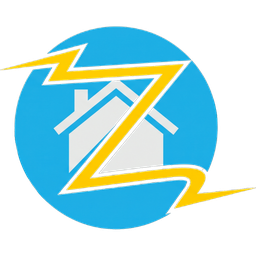

  

# Zonneburen voor Home Assistant

Maak van je Home Assistant de hub van je huis in de energiewijk Zonneburen. Je hebt dan geen
Zonneburen Link nodig: Home Assistant doet hetzelfde, met alles wat het al van je huis weet.

**In het kort:** installeren via de Marketplace → koppelcode uit de webapp invullen → je
slimme-metersensor kiezen. Klaar in vijf minuten.

## Wat het doet

- **Meedoen met de wijk.** Elke minuut gaat je netverbruik naar de wijk. Heeft de wijk stroom over,
  dan zet Home Assistant je boiler, laadpaal of ander apparaat aan.
- **De webapp werkt gewoon.** Live meekijken, Inzichten, Meldingen en Apparaten: de webapp ziet Home
  Assistant als je hub.
- **Elk apparaat uit Home Assistant.** Kies in de webapp bij *Apparaten* een schakelaar, lamp,
  thermostaat of boiler uit Home Assistant.
- **Je thuisbatterij slim laden** met het energieplan uit de webapp (optioneel, zie hieronder).
- **Noodstop van het bestuur** zet alles terug op normaal.

## Wat heb je nodig

- Home Assistant **2026.3 of nieuwer** (oudere versies werken vanaf 2024.12, maar tonen het logo niet).
- Een account in de Zonneburen-webapp.
- Een sensor in Home Assistant met het vermogen van je slimme meter (in W), bijvoorbeeld van een
  P1-meter, HomeWizard of je omvormer.

## 1. Installeren

Sinds Home Assistant 2026.11 heet HACS de **Marketplace** en zit het in Home Assistant zelf.

De knop opent Zonneburen meteen in je eigen Home Assistant. Werkt hij niet, voeg het dan zelf toe:

1. Ga naar **Instellingen → Marketplace**.
2. Kies **Add from link** (toevoegen via link) en vul in:
   `https://github.com/NiekSchouten/zonneburen-homeassistant`
   De eerste keer vraagt Home Assistant om in te loggen bij GitHub; dat leest alleen openbare gegevens.
3. Open **Zonneburen**, kies **Downloaden** en herstart Home Assistant.

Heb je Home Assistant 2026.10 of ouder (nog met HACS)?

1. Open **HACS**, kies rechtsboven de drie puntjes en dan **Aangepaste repositories**.
2. Vul `https://github.com/NiekSchouten/zonneburen-homeassistant` in, kies **Integratie** en voeg toe.
3. Zoek **Zonneburen**, download het en herstart Home Assistant.

## 2. Koppelen

Klik op de knop hierboven, of ga naar **Instellingen → Apparaten en diensten → Integratie
toevoegen** en kies **Zonneburen**.

1. **Koppelcode.** Maak in de webapp bij **Mijn hub** een koppelcode aan en vul die in. Het adres
   van de webapp laat je staan.
2. **Sensoren.** Kies bij **Net** de sensor van je slimme meter. Die moet positief zijn als je stroom
   afneemt; is het bij jou andersom, vink dan *Teken van het net omdraaien* aan. Zon, batterij en
   verbruik zijn optioneel en maken de grafieken in de webapp vollediger.

Dat is alles. Onder het apparaat **Zonneburen** zie je nu of je verbonden bent, of er wijkstroom loopt,
het overschot in de wijk, de beursprijs en wat je deze week deelde.

> **Let op:** draait er nog een Zonneburen Link of de oude Zonneburen-blueprint? Zet die dan uit (de
> blueprint onder **Instellingen → Automatiseringen en scènes**). Twee zenders op één adres tellen je
> verbruik dubbel; Home Assistant waarschuwt je als dat gebeurt.

Wil je later iets aanpassen? Kies bij de integratie **Configureren**.

## 3. Energieplan voor je batterij (optioneel)

De server maakt elk kwartier een plan voor je batterij: laden als stroom goedkoop is, ontladen als
hij duur is. Home Assistant voert dat plan uit en stuurt elke vijf seconden bij op je slimme meter.

1. Zet in de webapp bij **Energieplan** de stand op **Sturen**.
2. Kies in Home Assistant bij Zonneburen **Configureren** en klap **Energieplan** open.
3. Kies bij **Entiteit die het batterijvermogen instelt** de getal-entiteit (W) van je
   batterij-integratie. Onder elk veld staat wat het betekent.
4. Moet je batterij eerst in een stand voor externe sturing (veel omvormers hebben dat), kies dan ook
   de stand-entiteit en vul de standen voor *sturen* en *terugzetten* in.
5. Vink **Energieplan uitvoeren** aan en sla op.

Je krijgt er een sensor **Energieplan** bij (wat de batterij nu doet, met de komende blokken als
attributen), **Verwachte besparing**, een schakelaar **Energieplan uitvoeren** en knoppen om twee uur
te pauzeren of te hervatten.

**Altijd veilig.** Zonder geldig plan, bij een pauze, een noodstop of als je netsensor langer dan
een minuut niets meldt, zet de integratie het vermogen op 0 en de batterij terug in zijn eigen stand.
Een plan dat niet door de controle komt, wordt geweigerd; het vorige blijft dan gelden. Draait er ook
EMHASS, evcc of een ander energiebeheer, dan krijg je een melding: twee regelaars werken elkaar tegen.

## 4. Apparaten in het energieplan (optioneel, ook zonder batterij)

Vanaf 0.4.0 zet het energieplan ook je apparaten op het goedkoopste moment of op je eigen zon aan:
de auto, de boiler, de warmtepomp, een airco, elektrische verwarming, witgoed en een zwembadpomp.

1. Voeg het apparaat toe in de webapp bij **Apparaten** (een schakelaar, thermostaat of boiler uit
   Home Assistant).
2. Kies het in de webapp bij **Energieplan → Instellen → Apparaten in het plan**, en vul in wanneer
   het klaar moet zijn. Onder *Meer instellingen* staan onder andere een prijsgrens, weekdagen, een
   minimale looptijd en comfortgrenzen voor de warmtepomp.
3. Zet de webapp op **Sturen** en vink in Home Assistant **Energieplan uitvoeren** aan. Een
   batterij-entiteit is hiervoor niet nodig.

Bij een thermostaat of boiler zet het plan de temperatuur even hoger of lager; daarna gaat hij terug
naar de normale temperatuur uit Apparaten. Wat je zelf op *Handmatig* zet en de noodstop gaan altijd
voor. Bij een pauze of zonder geldig plan doen de apparaten weer wat ze normaal doen.

## Bijwerken

Een nieuwe versie verschijnt vanzelf onder **Instellingen → Updates**. De webapp biedt voor Home
Assistant geen firmware aan.

## Problemen oplossen

| Wat zie je | Wat doe je |
| --- | --- |
| *Deze code is onbekend of verlopen* | Maak in de webapp een nieuwe koppelcode aan. |
| *Verbonden met Zonneburen* staat uit | Controleer je internet; de integratie verbindt zelf opnieuw. |
| Verbruik in de webapp is dubbel of raar | Zet de Zonneburen Link of de oude blueprint uit, en controleer het teken van je netsensor. |
| Batterij doet niets | Staat *Energieplan uitvoeren* aan en staat de webapp op *Sturen*? Kijk in de sensor *Energieplan*. |
| Geen logo te zien | Werk Home Assistant bij naar 2026.3 of nieuwer. |

Kom je er niet uit? Kies bij de integratie **⋮ → Diagnose downloaden** en stuur dat bestand mee met je
vraag via [GitHub](https://github.com/NiekSchouten/zonneburen-homeassistant/issues). Het wachtwoord
van de broker staat er niet in.

## Goed om te weten

- De verbinding met de wijk loopt over een eigen account op de broker van Zonneburen, met TLS. Dat
  staat los van een MQTT-broker die je zelf in Home Assistant gebruikt.
- Wat je in Home Assistant zelf schakelt, blijft staan. Alleen een wijkcommando, de noodstop of een
  keuze in de webapp verandert iets.
- Witgoed, eigen zon eerst en een prijsgrens stel je per apparaat in bij het energieplan in de webapp
  (zie hierboven). De losse regels van de hub voor piekuren komen in een volgende versie.
